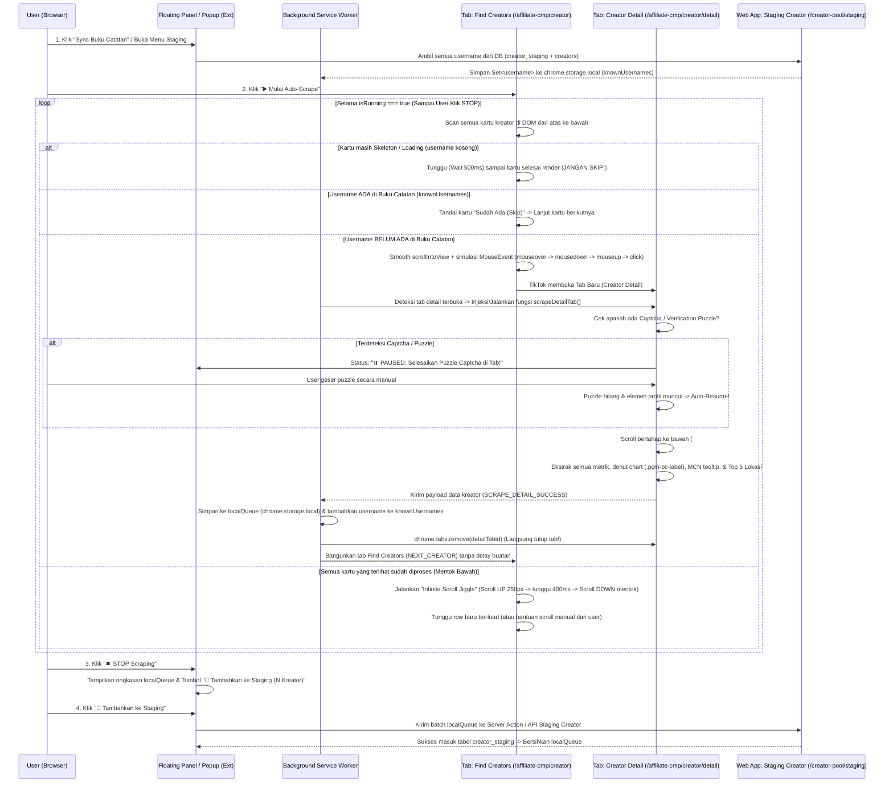

# Keputusan & Spesifikasi Teknis: Auto-Scraping Creator TikTok Partner Center & Sistem Staging Creator

**Tanggal:** 21 Oktober 2026
**Status:** Disetujui Owner (Siap Implementasi)
**Komponen Terkait:**
- `chrome-extension/` (`manifest.json`, `content.js`, `background.js`, `popup.html`, `popup.js`)
- `web-app/src/app/creator-pool/staging/` (Menu Sidebar baru: **Staging Creator**)
- `web-app/src/app/actions/creatorActions.ts` (Server Actions untuk Staging & Buku Catatan)
- `web-app/supabase/migrations/` (Tabel `creator_staging` & perluasan kolom metrik `creator_snapshots` / `creators`)

---

## 1. Ringkasan Keputusan Owner (12 Keputusan Kunci)

| # | Topik | Keputusan Owner | Dampak Teknis |
|---|---|---|---|
| 1 | **Pemisahan Nama TikTok vs Nama KTP** | `display_name` (nama profil TikTok) **dipisah** dari `nama_asli` (nama legal KTP/kontrak/pajak). | Hasil scrape menyimpan nama profil TikTok ke kolom `display_name`. Kolom `nama_asli` dibiarkan `NULL` sampai diisi tim legal/kontrak. |
| 2 | **Data yang TIDAK Diambil** | **Bio**, **Email**, dan **`gmv_raw_text`** **TIDAK diambil / disimpan**. | Hemat storage & bersih dari noise. Hanya WhatsApp (jika ada) yang diambil untuk kontak. |
| 3 | **Menu Baru: Staging Creator** | Buat menu sidebar baru bernama **Staging Creator** (`/creator-pool/staging`). | Hasil scrape masuk ke tabel `creator_staging` terlebih dahulu sebelum dipromosikan ke `creators` utama (*Creator Pool*). |
| 4 | **Buku Catatan Anti-Duplikat** | Ekstensi mengambil daftar seluruh `username` yang sudah ada di **Staging Creator** (`creator_staging` + `creators`) sebagai "Buku Catatan" sebelum mulai. | Saat membaca kartu di *Find Creators*, jika `username` sudah ada di Buku Catatan → **langsung dilewati (tidak diklik/dibuka tab-nya)**, lanjut ke kartu berikutnya. |
| 5 | **Penyimpanan Lokal Dulu → Tombol "Tambahkan ke Staging"** | Selama proses auto-scrape berjalan, data disimpan ke **local storage ekstensi (`chrome.storage.local`)** terlebih dahulu. | Saat user menekan tombol **⏹️ STOP Scraping**, muncul tombol **"Tambahkan ke Staging"** untuk mengirim seluruh antrean lokal ke database `creator_staging`. |
| 6 | **Loop Estafet Tanpa Jeda Buatan (0 Detik)** | Begitu tab detail selesai mengambil semua elemen (100% ter-load), tab langsung ditutup dan **langsung klik kartu berikutnya** tanpa jeda tunggu statis 2 detik. | Menggunakan *human-like micro-jitter* alami (`600ms–1500ms` saat scroll & *mouse hover/click*) agar tetap aman dari deteksi bot namun berkecepatan maksimal. |
| 7 | **Infinity Scroll Jangan Pernah Berhenti Otomatis** | Scraper **dilarang berhenti sendiri** meskipun scroll mentok di bawah. Hanya berhenti saat user klik tombol **⏹️ STOP**. | Karena halaman *Find Creators* adalah *infinite scroll* dan user kadang ikut membantu melakukan scrolling manual. |
| 8 | **Penanganan Loading Baris Acak (*Out-of-Order*) & *Scroll Jiggle*** | Baris di *Find Creators* kadang ter-load secara acak (misal baris 24 muncul lebih dulu daripada baris 22). Jika mentok di bawah, harus scroll ke atas sedikit lalu ke bawah lagi. | Scraper wajib mengecek ulang kartu dari atas ke bawah, **menunggu kartu yang masih *skeleton/loading*** (jangan di-skip), dan melakukan *scroll jiggle* (naik ~250px lalu turun lagi) saat mentok di bawah. |
| 9 | **Proteksi Anti-Bot & *Smart Pause* Captcha** | Jika TikTok memunculkan *puzzle/slider verification* di tab detail, scraper **langsung pause otomatis** dan **jangan menutup tab**. | Menunggu user menyelesaikan *puzzle* secara manual. Begitu *puzzle* selesai dan DOM profil muncul, scraper otomatis lanjut mengambil data, menutup tab, dan meneruskan estafet. |
| 10 | **Rumus GMV (`RIIL` vs `ESTIMASI`)** | Jika GMV terbuka (misal `Rp6,0M`), simpan angkanya dengan tag `RIIL`. Jika disensor (`Rp1JT+` / `--`), hitung nilai tengah `GMV per customer` × `Items sold`, tampilkan langsung di kolom GMV dengan tag `ESTIMASI`. Jika keduanya `--`, maka GMV = `0` (`RIIL`). | Tidak ada kolom `gmv_raw_text`. Hanya `gmv_30d` (bigint) + `gmv_status` (`'RIIL'` atau `'ESTIMASI'`). |
| 11 | **MCN & Sales Channel (`LIVE` / `Video` / `Product cards`)** | Kreator kadang tidak punya MCN (`--` atau elemen tidak ada → `NULL`). Di *GMV per sales channel*, kreator bisa hanya `LIVE`, hanya `Video`, atau kombinasi. | Semua channel diinisialisasi `0%` (`Rp 0`), lalu diisi sesuai label `.pcm-pc-label` yang muncul di donut chart dan dikalikan dengan `gmv_30d`. |
| 12 | **Niche Otomatis & Top 5 Lokasi (JSONB Tags)** | Niche utama ditentukan otomatis dari kategori dengan persentase tertinggi di chart *GMV by product category*. Lokasi disimpan Top 5 saja sebagai JSONB dan ditampilkan berupa *pill tags*. | Tidak perlu hover kategori di header. Contoh JSON lokasi: `[{"loc": "West Java", "pct": 20}, {"loc": "Jakarta", "pct": 10}, ...]`. |

---

## 2. Arsitektur & Alur Kerja End-to-End



---

## 3. Peta Lengkap Selektor DOM (`partner.tiktokshop.com`)

Seluruh selektor di bawah ini telah diverifikasi langsung dari *live DOM* TikTok Partner Center (`garfish_app_for_affiliate-cmp`).

### 3.1 Halaman Daftar Kreator (*Find Creators*)
**URL:** `https://partner.tiktokshop.com/affiliate-cmp/creator?market=4`

| Elemen | Selektor DOM Utama | Selektor Fallback / Catatan |
|---|---|---|
| **Scroll Container Utama** | `div[data-e2e="9d644e6c-6279-450c"] > div[style*="overflow: scroll"]` | Cari elemen `div` di dalam `[data-e2e="9d644e6c-6279-450c"]` yang memiliki `scrollHeight > clientHeight`. |
| **Baris Virtual / Row Container** | `div[data-e2e="e8faf26e-bf66-5abe"]` | Setiap baris memuat 1 kartu kreator + 3 thumbnail video di sebelahnya. |
| **Area Klik Profil Kartu** | `div[data-e2e="0fca897b-b18b-1087"]` | Elemen ini yang diklik untuk membuka tab detail kreator (`CreatorDetails?...`). |
| **Username di Kartu** | `span[data-e2e="fbc99397-6043-1b32"]` | Contoh teks: `williesalim`. Wajib `.trim().toLowerCase()`. Jika elemen belum ada / teks kosong, berarti baris masih **skeleton/loading**. |
| **Display Name di Kartu** | `span[data-e2e="3b9caa65-c65a-e9dc"]` | Contoh teks: `Willie Salim` |
| **Badge Level di Kartu** | `div[data-e2e="190b477a-d59c-ce17"]` | Contoh teks: `LVL 7` |
| **Kategori di Kartu** | `span[data-e2e="6e905dae-25bf-454b"]` | Contoh teks: `Beauty & Personal Care, Food & Beverages` |
| **Ringkasan Followers/Gender/Umur** | `span[data-e2e="9e8f2473-a87f-db74"]` | Contoh teks: `74.5M, Male 34%, 25-34` |
| **GMV di Kartu** | `span[data-e2e="dfa39213-a263-5c80"]` | Contoh teks: `Rp1JT+` atau `Rp6,0M` |
| **Items Sold di Kartu** | `span[data-e2e="84077312-3e9e-6c5e"]` | Contoh teks: `5.63K` |
| **Avg. Video Views di Kartu** | `span[data-e2e="ac42cf72-8039-7ab4"]` | Contoh teks: `12.69K` |

---

### 3.2 Halaman Detail Kreator (*Creator Details*)
**URL:** `https://partner.tiktokshop.com/affiliate-cmp/creator/detail?cid=...`

#### A. Header Profil Kreator
| Field | Selektor DOM Utama | Aturan Ekstraksi & Fallback |
|---|---|---|
| `tiktok_cid` | `new URLSearchParams(location.search).get('cid')` | ID unik internal TikTok Affiliate untuk kreator tersebut (contoh: `7494009753827576542`). |
| `avatar_url` | `img[data-e2e="e7714c21-c02b-bb8b"]` | Fallback: `.m4b-avatar-image img`. Ambil atribut `.src`. |
| `username` | `span[data-e2e="b7f56c3b-f013-3448"]` | Fallback: `span.text-head-l`. Bersihkan `@`, `.trim().toLowerCase()`. |
| `display_name` | `span[data-e2e="72a4feaf-82c8-ddda"]` | Nama tampilan TikTok (contoh: `Willie Salim`). **JANGAN dimasukkan ke `nama_asli`!** |
| `level` | `div[data-e2e="190b477a-d59c-ce17"]` | Ekstrak angka dari `LVL 7` → `7` (`integer`). |
| `followers` | `span[data-e2e="7aed0dd7-48ba-6932"]` | Contoh: `74.5M` → konversi lewat parser Non-Rupiah menjadi `74500000`. |
| `mcn` | `span[data-e2e="85040a36-fb50-9f7c"]` | 1. Jika elemen tidak ada atau bernilai `--` / kosong → set `null` (Kreator Independen / Tanpa MCN).<br>2. Jika teks terpotong (`...` atau `scrollWidth > clientWidth`), trigger `mouseenter`/`mouseover` pada elemen tersebut, tunggu `150ms`, lalu baca teks lengkap dari `.arco-tooltip-content` / `[role="tooltip"]`. Jika tidak ada tooltip, ambil teks yang terlihat. |
| `no_whatsapp` | Tombol/popover kontak (`[data-e2e="018d0d04-b78c-d5c0"]`) | Hanya diambil jika kreator membuka nomor WhatsApp/telepon di kontak. **Email dan Bio diabaikan.** |

#### B. Kartu Metrik Utama (*Sales*, *Collaboration Metrics*, *Video*, *LIVE*)
Semua kartu metrik memiliki struktur seragam:
- **Container Kartu:** `div[data-e2e="f6855061-9011-24ab"]`
- **Label Nama Metrik:** `span[data-e2e="61148565-2ea3-4c1b"]` (ambil `.textContent.trim()`)
- **Nilai Metrik:** `.creator_video_data_card_trigger_is_display` di dalam kartu yang sama (ambil `.textContent.trim()`)

| Label di TikTok (`span[data-e2e="61148565-2ea3-4c1b"]`) | Contoh Nilai di DOM | Kolom Database Target | Cara Parsing |
|---|---|---|---|
| `GMV` | `Rp1JT+` / `Rp6,0M` / `--` | `gmv_30d` & `gmv_status` | Lihat **§4.2 Rumus GMV (`RIIL` vs `ESTIMASI`)** |
| `Items sold` | `5.63K` | `items_sold_30d` | Parser Non-Rupiah (`5.63K` → `5630`) |
| `GPM` | `Rp25,0rb` | `gpm_30d` | Parser Rupiah (`Rp25,0rb` → `25000`) |
| `GMV per customer` | `Rp179,8rb-Rp269,8rb` | `gmv_per_customer_min`, `gmv_per_customer_max` | Pecah dengan `-`, parse keduanya dengan Parser Rupiah (`179800` & `269800`). Jika satu nilai pasti, `min = max`. |
| `Avg. commission rate` | `9%` | `avg_commission_rate` | Hapus `%`, parse sebagai `numeric(5,2)` (`9.00`) |
| `Products` | `151` | `products_promoted_count` | Parse integer (`151`) |
| `Brand collaborations` | `47` | `brand_collaborations_count` | Parse integer (`47`) |
| `Product price` | `Rp300-Rp16,0JT` | `product_price_min`, `product_price_max` | Pecah dengan `-`, parse keduanya dengan Parser Rupiah (`300` & `16000000`) |
| `Video GPM` | `Rp25,0rb` | `video_gpm` | Parser Rupiah (`25000`) |
| `Videos` | `4` | `videos_count_30d` | Parse integer (`4`) |
| `Avg. video views` | `12.69K` | `avg_video_views` | Parser Non-Rupiah (`12690`) |
| `Avg. video engagement rate` | `5.2%` | `avg_video_engagement_rate` | Hapus `%`, parse `numeric(5,2)` (`5.20`) |
| `LIVE GPM` | `Rp14,6rb` | `live_gpm` | Parser Rupiah (`14600`) |
| `LIVE streams` | `67` | `live_streams_count_30d` | Parse integer (`67`) |
| `Avg. LIVE views` | `10.17K` | `avg_live_views` | Parser Non-Rupiah (`10170`) |
| `Avg. LIVE engagement rate` | `3.9%` | `avg_live_engagement_rate` | Hapus `%`, parse `numeric(5,2)` (`3.90`) |

#### C. Empat Donut Chart (Membaca Node `.pcm-pc-label` Langsung Tanpa Hover Canvas)
TikTok merender elemen label HTML `.pcm-pc-label` di dalam masing-masing pembungkus chart. Setiap `.pcm-pc-label` memiliki:
- Nama item: `.pcm-pc-label-name`
- Persentase: `.pcm-pc-label-percent` (contoh: `99.92%`)

| Nama Chart | Selektor Container | Aturan Ekstraksi & Edge Cases |
|---|---|---|
| **1. GMV per sales channel** | `div[data-e2e="4ae5aa7b-adbf-5b23"]` | - Inisialisasi awal: `pct_live = 0`, `pct_video = 0`, `pct_showcase = 0`.<br>- Iterasi semua `.pcm-pc-label`:<br>  • `name === 'LIVE'` → `pct_live`<br>  • `name === 'Video'` → `pct_video`<br>  • `name === 'Product cards'` → `pct_showcase`<br>- **Edge Case:** Kreator yang hanya jualan dari Video hanya punya 1 node `Video` (`100%`), sedangkan `LIVE` tidak dirender. Karena sudah diinisialisasi `0`, maka `pct_live` otomatis `0` (`Rp 0`). Begitu pula sebaliknya untuk kreator yang hanya `LIVE`. |
| **2. GMV by product category** | `div[data-e2e="01d39cce-708e-bf0e"]` | - Iterasi semua `.pcm-pc-label` → simpan array `[{ category, pct }]` ke `gmv_by_category` (JSONB), urutkan dari `pct` terbesar.<br>- **Penentuan Niche Utama Otomatis:** Kategori dengan `pct` tertinggi otomatis menjadi `primary_niche` (contoh: `Beauty & Personal Care` `41.10%` → `primary_niche = 'Beauty & Personal Care'`).<br>- Fallback: Jika chart kosong (kreator belum punya GMV 30 hari), ambil kategori pertama dari teks sub-header profil (`span.text-neutral-text3`). |
| **3. Followers Gender** | `div[data-e2e="cf2d5c63-63ea-cf11"]` | - Iterasi `.pcm-pc-label`:<br>  • `Male` → `audience_male_pct` (contoh: `34.12`)<br>  • `Female` → `audience_female_pct` (contoh: `65.88`) |
| **4. Followers Age** | `div[data-e2e="27e78e14-baa5-9b09"]` | - Iterasi `.pcm-pc-label`:<br>  • `18 - 24` → `age_18_24_pct`<br>  • `25 - 34` → `age_25_34_pct`<br>  • `35-44` / `35 - 44` → `age_35_44_pct`<br>  • `45-54` / `45 - 54` → `age_45_54_pct`<br>  • `55+` → `age_55_plus_pct`<br>- Kelompok umur dengan persentase tertinggi disimpan juga ke `audience_age` (contoh: `'25 - 34'`). |

#### D. Horizontal Bar Chart: Top 5 Locations (`#followers_tab`)
- **Container:** `div[data-e2e="27e78e14-baa5-9b08"]`
- **Elemen Chart:** `.ecom-data-horizontal-barchart__chart`
- **Metode Ekstraksi Berjenjang (Dual-Strategy):**
  1. **Strategi A (React Fiber Props — Instan & Akurat):**
     Cari key properti pada elemen `.ecom-data-horizontal-barchart__chart` atau parent-nya yang diawali `__reactFiber$` atau `__reactProps$`. Telusuri `memoizedProps` / `return.memoizedProps` untuk menemukan array `data` dari komponen Horizontal Bar Chart (berisi pasangan nama provinsi/lokasi dan nilai persentasenya).
  2. **Strategi B (Simulasi Sweep Tooltip Canvas — Fallback Pasti Dapat):**
     Jika dibungkus Shadow/Garfish sehingga Fiber tidak mengekspos array data, lakukan *vertical sweep* pada `<canvas>` di dalam `div[data-e2e="27e78e14-baa5-9b08"]`:
     - Ambil `rect = canvas.getBoundingClientRect()`.
     - Terdapat maksimal 5 bar horizontal yang tersebar merata secara vertikal.
     - Untuk `i = 0` s.d. `4`, hitung `y = rect.top + (rect.height / 5) * (i + 0.5)` dan `x = rect.left + rect.width * 0.4`.
     - Dispatch `new MouseEvent('mousemove', { clientX: x, clientY: y, bubbles: true })` pada `canvas`.
     - Tunggu `40ms`, baca `.lightcharts-tooltip-title` (nama lokasi, misal `West Java`) dan `.lightcharts-tooltip-item` (persentase, misal `20%`).
- **Format Penyimpanan DB (`top_locations` JSONB):**
  ```json
  [
    { "loc": "West Java", "pct": 20.5 },
    { "loc": "Jakarta", "pct": 14.2 },
    { "loc": "East Java", "pct": 12.8 },
    { "loc": "Central Java", "pct": 9.4 },
    { "loc": "Banten", "pct": 6.1 }
  ]
  ```
- **Format Tampilan di UI:** Ditampilkan sebagai deretan *pill tags* ringkas:
  `West Java 20.5%` `Jakarta 14.2%` `East Java 12.8%` `Central Java 9.4%` `Banten 6.1%`

---

## 4. Aturan Parsing Angka & Rumus Kalkulasi GMV (Sangat Kritis)

### 4.1 Jebakan Huruf `"M"` (Format Rupiah vs Format Inggris)
Di halaman TikTok Partner Center Indonesia, TikTok mencampur bahasa Indonesia untuk mata uang (`Rp`) dan bahasa Inggris untuk angka non-mata uang (`Followers`, `Items sold`, `Views`).

> [!CAUTION]
> **JANGAN PERNAH menggunakan satu fungsi parser yang sama untuk Rupiah dan Non-Rupiah!**
> - Pada **Rupiah (`Rp6,0M`)**: huruf **`M`** adalah **Miliar ($\times 1.000.000.000$ / $10^9$)** dan pemisah desimalnya adalah **koma (`,`)**.
> - Pada **Non-Rupiah (`74.5M` followers)**: huruf **`M`** adalah **Million / Juta ($\times 1.000.000$ / $10^6$)** dan pemisah desimalnya adalah **titik (`.`)**.

#### Fungsi 1: `parseIdrCurrency(rawText)` (Khusus string yang mengandung `Rp`)
1. Jika `!rawText` atau `rawText.includes('--')` atau `rawText.includes('+')` (seperti `Rp1JT+`), kembalikan `null` (menandakan tidak ada angka pasti / disensor).
2. Bersihkan prefix `Rp` dan spasi: `Rp179,8rb` → `179,8rb`.
3. Ubah koma desimal menjadi titik: `179,8rb` → `179.8rb`.
4. Deteksi suffix (case-insensitive):
   - `RB` atau `K` → $\times 1.000$ ($10^3$)
   - `JT` → $\times 1.000.000$ ($10^6$)
   - `M` → $\times 1.000.000.000$ ($10^9$ — **Miliar**)
   - `T` → $\times 1.000.000.000.000$ ($10^{12}$ — **Triliun**)
5. Kalikan `parseFloat(angka)` dengan multiplier lalu `Math.round()`.

#### Fungsi 2: `parseCompactCount(rawText)` (Khusus Followers, Views, Items Sold — Tanpa `Rp`)
1. Jika `!rawText` || `rawText.includes('--')`, kembalikan `0`.
2. Deteksi suffix (case-insensitive):
   - `K` → $\times 1.000$ ($10^3$)
   - `M` → $\times 1.000.000$ ($10^6$ — **Million / Juta**)
   - `B` → $\times 1.000.000.000$ ($10^9$ — **Billion / Miliar**)
3. Kalikan `parseFloat(angka)` dengan multiplier lalu `Math.round()`.

---

### 4.2 Rumus Penentuan `gmv_30d` & `gmv_status` (`RIIL` vs `ESTIMASI`)

TikTok menyensor GMV kreator tertentu menjadi `Rp1JT+` atau `--`, namun tetap menampilkan `Items sold` (misal `5.63K`) dan rentang `GMV per customer` (misal `Rp179,8rb-Rp269,8rb`).

#### Kasus 1: GMV Terbuka / Pasti (Contoh: `Rp6,0M` atau `Rp450,5JT`)
- `GMV` tidak mengandung `+` dan bukan `--`.
- `gmv_30d = parseIdrCurrency(gmvText)` → contoh: `6000000000`.
- `gmv_status = 'RIIL'`.

#### Kasus 2: GMV Disensor (`Rp1JT+` atau `--`), tetapi `GMV per customer` & `Items sold` Tersedia
- Contoh di profil Willie Salim:
  - `GMV` = `Rp1JT+` (disensor)
  - `Items sold` = `5.63K` → `items_sold_30d = 5630`
  - `GMV per customer` = `Rp179,8rb-Rp269,8rb` → `min = 179800`, `max = 269800`
- Hitung nilai tengah (*midpoint*) `GMV per customer`:
  $$\text{Midpoint} = \frac{179.800 + 269.800}{2} = 224.800$$
- Kalikan dengan `items_sold_30d`:
  $$\text{gmv\_30d} = \text{ROUND}(5.630 \times 224.800) = \text{Rp } 1.265.624.000$$
- `gmv_status = 'ESTIMASI'`.
- Di UI Staging & Creator Pool, angka `Rp 1.265.624.000` langsung ditampilkan di kolom GMV dengan badge kuning **`ESTIMASI`**.

#### Kasus 3: GMV `--` DAN `GMV per customer` `--` (Memang Belum Ada Penjualan)
- `gmv_30d = 0`
- `gmv_status = 'RIIL'`

---

### 4.3 Rumus Pecahan GMV per Sales Channel (`LIVE`, `Video`, `Product cards`)
Setelah `gmv_30d` didapat (baik `RIIL` maupun `ESTIMASI`), nilai rupiah per channel dihitung langsung dari persentase donut chart *GMV per sales channel*:

$$\text{gmv\_30d\_live} = \text{ROUND}\left(\text{gmv\_30d} \times \frac{\text{pct\_live}}{100}\right)$$
$$\text{gmv\_30d\_video} = \text{ROUND}\left(\text{gmv\_30d} \times \frac{\text{pct\_video}}{100}\right)$$
$$\text{gmv\_30d\_showcase} = \text{ROUND}\left(\text{gmv\_30d} \times \frac{\text{pct\_showcase}}{100}\right)$$

- Jika seorang kreator hanya memiliki `Video 100%` (tanpa label `LIVE` di chart), maka:
  - `gmv_30d_video = gmv_30d`
  - `gmv_30d_live = 0`
  - `gmv_30d_showcase = 0`
- Jika seorang kreator hanya memiliki `LIVE 100%` (tanpa label `Video` di chart), maka:
  - `gmv_30d_live = gmv_30d`
  - `gmv_30d_video = 0`
  - `gmv_30d_showcase = 0`

---

## 5. Penanganan *Infinite Scroll*, Loading Baris Acak, & Proteksi Anti-Bot

### 5.1 Mengatasi Loading Baris Acak (*Out-of-Order Row Rendering*)
Di halaman *Find Creators*, saat daftar di-scroll, TikTok memuat baris secara asinkron dan tidak berurutan (misal baris ke-24 selesai *render* lebih dulu daripada baris ke-22).
- **Larangan:** Jangan pernah menggunakan *counter index* statis (`currentIndex++`) yang hanya maju ke bawah tanpa menengok baris di atasnya yang tadi belum ter-load.
- **Solusi Algoritma Pemindaian:**
  1. Pada setiap siklus, ambil seluruh elemen baris `div[data-e2e="e8faf26e-bf66-5abe"]` yang ada di DOM saat itu dari urutan paling atas ke bawah.
  2. Untuk setiap baris, cek apakah sudah punya atribut internal `data-tnt-processed="true"`. Jika sudah, lewati.
  3. Cek elemen username `span[data-e2e="fbc99397-6043-1b32"]` di dalam baris tersebut:
     - **Jika elemen username belum ada atau teksnya masih kosong (sedang *skeleton/loading*):**
       **BERHENTI & TUNGGU!** Jangan melompati baris ini ke baris di bawahnya. Scroll baris tersebut ke tengah layar (`scrollIntoView({ behavior: 'smooth', block: 'center' })`), lalu tunggu hingga maksimal `5 detik` (polling tiap `300ms`) sampai teks username muncul.
     - **Jika teks username sudah muncul:**
       - Cek apakah `username` ada di `knownUsernames` (Buku Catatan):
         - **Jika ADA:** Beri tanda `data-tnt-processed="true"` + badge visual hijau `"⏭️ Sudah di Staging"`, lalu lanjut periksa baris berikutnya di loop yang sama (tanpa membuka tab).
         - **Jika BELUM ADA:** Beri tanda `data-tnt-processed="true"`, klik kartu untuk membuka tab detail, dan tunggu sinyal `NEXT_CREATOR` dari background worker setelah tab detail selesai di-scrape dan ditutup.

### 5.2 Mekanisme *Infinite Scroll "Jiggle"* & Loop Tanpa Henti
Ketika seluruh baris yang ada di DOM sudah bertanda `data-tnt-processed="true"`:
1. Scraper **TIDAK BOLEH BERHENTI**.
2. Ambil `scrollContainer` (`div[data-e2e="9d644e6c-6279-450c"] > div[style*="overflow: scroll"]`).
3. Scroll ke paling bawah: `scrollContainer.scrollTo({ top: scrollContainer.scrollHeight, behavior: 'smooth' })`.
4. Tunggu `1000ms`. Jika jumlah kartu belum bertambah (sensor *infinite scroll* TikTok macet karena mentok):
   - **Lakukan *Scroll Jiggle*:**
     - Scroll NAIK sedikit (`scrollContainer.scrollBy({ top: -260, behavior: 'smooth' })`).
     - Tunggu `450ms`.
     - Scroll TURUN kembali ke mentok bawah (`scrollContainer.scrollTo({ top: scrollContainer.scrollHeight, behavior: 'smooth' })`).
5. Ulangi pemindaian setiap `1200ms`. Jika user membantu melakukan scroll manual atau mengubah filter di layar, pemindai otomatis mendeteksi baris-baris baru yang muncul dan langsung memprosesnya.
6. Loop ini hanya berhenti ketika user mengklik tombol **⏹️ STOP Scraping**.

### 5.3 Wajib Ter-load 100% di Tab Detail Sebelum Ambil Data
Begitu tab detail kreator terbuka (`/affiliate-cmp/creator/detail?cid=...`):
1. Tunggu hingga header profil (`span[data-e2e="b7f56c3b-f013-3448"]`) dan kartu metrik (`div[data-e2e="f6855061-9011-24ab"]`) muncul di DOM.
2. **Scroll Bertahap ke Bawah (*Lazy-Load Trigger*):**
   - Scroll ke bagian `#collaborations_tab` → tunggu `250ms`.
   - Scroll ke bagian `#followers_tab` (tempat chart Gender, Age, dan Top Locations berada) → tunggu `350ms`.
   - Scroll ke bagian `#trends_tab` (paling bawah) → tunggu `250ms`.
3. **Verifikasi Kelengkapan Elemen:**
   Pastikan elemen chart di `#followers_tab` (`div[data-e2e="cf2d5c63-63ea-cf11"]`, `div[data-e2e="27e78e14-baa5-9b09"]`, `div[data-e2e="27e78e14-baa5-9b08"]`) sudah ter-render (atau tampil placeholder *No data* resmi dari TikTok) sebelum membaca angkanya.

### 5.4 *Human-Like Interaction* & *Smart Pause* Captcha
1. **Simulasi Klik Manusia:** Saat membuka kartu di *Find Creators*, jangan hanya memanggil `.click()`. Pastikan kartu masuk ke viewport dengan `scrollIntoView`, beri jeda acak `600ms–1400ms`, lalu kirim urutan event `mouseover` → `mousedown` → `mouseup` → `click` dengan koordinat `clientX/clientY` di dalam area kartu.
2. **Deteksi Captcha / Puzzle Verification:**
   - Di tab detail, pantau keberadaan elemen modal verifikasi TikTok (`#captcha_container`, `.captcha_verify_container`, `iframe[src*="captcha"]`, `.secsdk-captcha-drag-icon`, atau teks `"Drag the slider to fit the puzzle"`).
   - Jika terdeteksi (atau jika dalam `8 detik` elemen profil belum muncul karena tertahan puzzle):
     - Set status ke **`⏸️ PAUSED_CAPTCHA`** dan bunyikan notifikasi visual di panel ekstensi.
     - **JANGAN TUTUP TAB DETAIL!** Biarkan tab tetap terbuka dan aktif.
     - Polling setiap `1000ms` sampai elemen captcha hilang dan elemen `span[data-e2e="b7f56c3b-f013-3448"]` muncul.
     - Begitu muncul, otomatis lanjutkan ekstraksi data, tutup tab, dan lanjutkan estafet tanpa kehilangan 1 pun kreator.

---

## 6. Skema Database (`creator_staging` & Pemetaan ke `creators` / `creator_snapshots`)

### 6.1 Tabel Baru: `creator_staging`
Dibuat melalui file migrasi SQL baru di `web-app/supabase/migrations/`.

```sql
CREATE TABLE IF NOT EXISTS creator_staging (
    id serial PRIMARY KEY,
    username text NOT NULL UNIQUE,
    display_name text,
    tiktok_cid text,
    link_account text,
    avatar_url text,
    mcn text,
    no_whatsapp text,
    level integer,
    followers bigint,
    primary_niche text,

    -- GMV & Sales Metrics (30 Hari Terakhir)
    gmv_30d bigint NOT NULL DEFAULT 0,
    gmv_status text NOT NULL DEFAULT 'RIIL' CHECK (gmv_status IN ('RIIL', 'ESTIMASI')),
    gmv_30d_live bigint NOT NULL DEFAULT 0,
    gmv_30d_video bigint NOT NULL DEFAULT 0,
    gmv_30d_showcase bigint NOT NULL DEFAULT 0,
    pct_live numeric(5,2) DEFAULT 0,
    pct_video numeric(5,2) DEFAULT 0,
    pct_showcase numeric(5,2) DEFAULT 0,

    items_sold_30d bigint DEFAULT 0,
    gpm_30d bigint DEFAULT 0,
    gmv_per_customer_min bigint,
    gmv_per_customer_max bigint,
    avg_commission_rate numeric(5,2),

    -- Collaboration Metrics
    products_promoted_count integer DEFAULT 0,
    brand_collaborations_count integer DEFAULT 0,
    product_price_min bigint,
    product_price_max bigint,

    -- Video Performance Metrics
    video_gpm bigint DEFAULT 0,
    videos_count_30d integer DEFAULT 0,
    avg_video_views bigint DEFAULT 0,
    avg_video_engagement_rate numeric(5,2),

    -- LIVE Performance Metrics
    live_gpm bigint DEFAULT 0,
    live_streams_count_30d integer DEFAULT 0,
    avg_live_views bigint DEFAULT 0,
    avg_live_engagement_rate numeric(5,2),

    -- Audience Demographics & Category Breakdown
    audience_male_pct numeric(5,2),
    audience_female_pct numeric(5,2),
    audience_age text, -- Kelompok umur dominan (misal '25 - 34')
    age_18_24_pct numeric(5,2),
    age_25_34_pct numeric(5,2),
    age_35_44_pct numeric(5,2),
    age_45_54_pct numeric(5,2),
    age_55_plus_pct numeric(5,2),
    top_locations jsonb DEFAULT '[]'::jsonb, -- Top 5: [{"loc": "West Java", "pct": 20.5}, ...]
    gmv_by_category jsonb DEFAULT '[]'::jsonb, -- [{"category": "Beauty & Personal Care", "pct": 41.1}, ...]

    -- Metadata Staging & Promosi ke Creator Pool
    status_staging text NOT NULL DEFAULT 'staged' CHECK (status_staging IN ('staged', 'promoted', 'archived')),
    promoted_creator_id integer REFERENCES creators(id) ON DELETE SET NULL,
    scraped_by text REFERENCES profiles(id) ON DELETE SET NULL,
    scraped_at timestamptz NOT NULL DEFAULT now(),
    updated_at timestamptz NOT NULL DEFAULT now()
);

CREATE INDEX IF NOT EXISTS idx_creator_staging_username_lower ON creator_staging (LOWER(username));
CREATE INDEX IF NOT EXISTS idx_creator_staging_status ON creator_staging (status_staging);
CREATE INDEX IF NOT EXISTS idx_creator_staging_gmv ON creator_staging (gmv_30d DESC);
```

### 6.2 Perluasan Kolom pada `creators` & `creator_snapshots`
Agar saat kreator di-**Promote / Pindahkan dari Staging ke Creator Pool** tidak ada satu pun data analitik yang hilang:
1. **`creators`:**
   - Tambah `display_name text` (untuk menyimpan nama profil TikTok terpisah dari `nama_asli` KTP).
2. **`creator_snapshots`:**
   - Tambah kolom metrik lengkap hasil scrape (`gmv_status`, `gmv_30d_showcase`, `pct_live`, `pct_video`, `pct_showcase`, `items_sold_30d`, `gpm_30d`, `gmv_per_customer_min`, `gmv_per_customer_max`, `avg_commission_rate`, `products_promoted_count`, `brand_collaborations_count`, `product_price_min`, `product_price_max`, `video_gpm`, `videos_count_30d`, `avg_video_views`, `avg_video_engagement_rate`, `live_gpm`, `live_streams_count_30d`, `avg_live_views`, `avg_live_engagement_rate`, `audience_male_pct`, `audience_female_pct`, `age_18_24_pct`, `age_25_34_pct`, `age_35_44_pct`, `age_45_54_pct`, `age_55_plus_pct`, `top_locations`, `gmv_by_category`).

---

## 7. Desain Halaman **Staging Creator** (`/creator-pool/staging`)

1. **Posisi di Sidebar:**
   - Di bawah grup navigasi Creator / Database Kreator: menu **"Staging Creator"** (`/creator-pool/staging`).
2. **Fitur Utama Halaman Staging Creator:**
   - **Sinkronisasi Buku Catatan Ekstensi:** Menyediakan data daftar seluruh `username` (`creator_staging` + `creators`) yang otomatis dibaca oleh Chrome Extension saat halaman dibuka atau saat tombol Sync di-klik.
   - **Penerima Injeksi Batch ("Tambahkan ke Staging"):** Menerima payload dari tombol **"Tambahkan ke Staging"** di ekstensi dan melakukan `UPSERT` (`ON CONFLICT (username) DO UPDATE`) ke tabel `creator_staging` (sesuai aturan proyek: gunakan upsert, jangan replace yang menghapus histori).
   - **Filter & Sorting Cepat:**
     - Cari berdasarkan Username / Display Name / MCN
     - Filter Niche Utama (`primary_niche`)
     - Filter Status GMV (`RIIL` / `ESTIMASI`)
     - Filter Level (`LVL 1` – `LVL 8`)
     - Filter Channel Dominan (`LIVE Heavy`, `Video Heavy`)
     - Urutkan berdasarkan `GMV 30D`, `Followers`, `Avg. Video Views`, `Avg. LIVE Views`, atau `Waktu Scrape`.
   - **Tampilan Tabel Kaya Analitik:**
     - Profil (`avatar_url`, `@username`, `display_name`, badge `LVL`, badge `MCN` atau `No MCN`, badge `primary_niche`)
     - **Total GMV 30D** + badge hijau `RIIL` atau kuning `ESTIMASI` + breakdown `LIVE` / `Video` / `Showcase`
     - **Sales & Collab:** Items Sold, GPM, GMV/Customer, Komisi %, Produk & Brand Collab
     - **Performa Video & LIVE:** Jumlah Video, Avg Views, ER%, Video GPM, Jumlah LIVE, Avg LIVE Views, LIVE ER%, LIVE GPM
     - **Demografi Followers:** Bar % Male/Female, Umur dominan + rincian %, dan **Top 5 Lokasi** berupa *pill tags* (`West Java 20%`, `Jakarta 10%`, dst.)
   - **Aksi Promosi ke Creator Pool:**
     - Checkbox pilih beberapa / pilih semua kreator di Staging → tombol **"Pindahkan ke Creator Pool"** (membuat/mengupdate baris di `creators`, membuat snapshot lengkap di `creator_snapshots`, menautkan `primary_niche` ke `creator_niches`, dan mengubah `status_staging = 'promoted'`).
