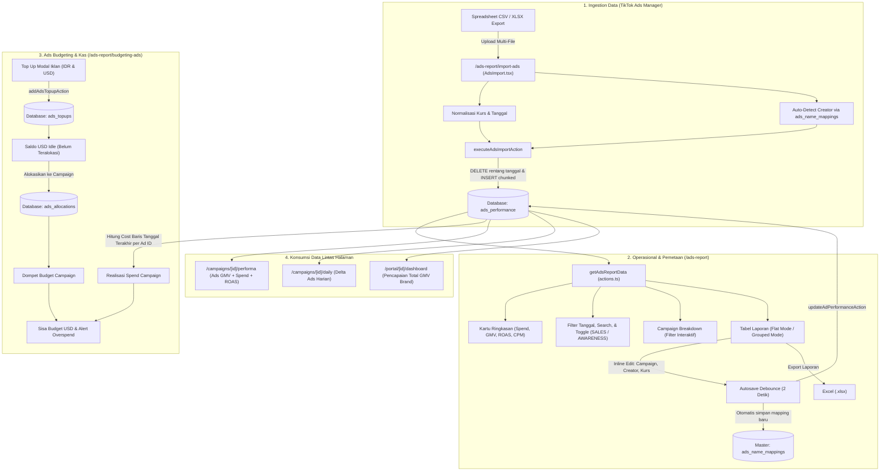

# Dokumentasi Sistem Laporan Ads, Budgeting, & Mapping End-to-End

> **Modul**: Laporan Ads & Performa (`/ads-report`, `/ads-report/budgeting-ads`, `/ads-report/import-ads`)  
> **Target Pengguna**: Manager, Media Buyer / Ads Specialist, Finance, Executive  
> **Terakhir Diperbarui**: 26 Oktober 2026

---

## 1. Peta Alur Arsitektur End-to-End

---

## 2. Struktur Data & Skema Database

### A. Tabel Utama: `ads_performance`
Menyimpan riwayat kinerja iklan harian dari TikTok Ads Manager:
- `id` (serial PK)
- `ad_id` (varchar) — ID Iklan unik dari TikTok.
- `ad_name` (varchar) — Nama iklan / creative.
- `campaign_ads_name` (varchar) — Nama campaign di TikTok Ads Manager (contoh: `SALES - Salsa Cosmetic`).
- `campaign_id` (integer FK) — ID Campaign sistem TNT yang terhubung.
- `creator_id` (integer FK) — ID Kreator yang videonya diiklankan.
- `product_id` (varchar) — ID produk TikTok Shop yang diiklankan.
- `tanggal` (date) — Tanggal data performa.
- `cost_usd` (numeric) — Biaya iklan dalam USD (kumulatif all-time per ad_id).
- `gross_revenue_usd` (numeric) — Pendapatan kotor dalam USD (kumulatif all-time per ad_id).
- `kurs` (numeric) — Nilai tukar USD $\rightarrow$ IDR pada baris tersebut (default 16.000).
- `impressions`, `clicks`, `purchases`, `product_page_views`, `checkouts_initiated`, `items_purchased` (integer/numeric).
- `raw_data` (jsonb) — Data mentah asli dari baris spreadsheet TikTok.

### B. Tabel Master Mapping: `ads_name_mappings`
Pencegah kerja ganda pemetaan:
- `ad_name` (varchar PK) — Nama iklan unik.
- `creator_id` (integer) — Kreator yang terhubung.
- `campaign_id` (integer) — Campaign yang terhubung.
- `product_id` (varchar) — Produk yang terhubung.

### C. Tabel Budgeting: `ads_topups` & `ads_allocations`
- `ads_topups`: Mencatat setoran modal iklan (`nominal_idr`, `kurs_topup`, `nominal_usd`, `catatan`, `tanggal`).
- `ads_allocations`: Mencatat jatah budget ke campaign (`campaign_id`, `alokasi_usd`, `alokasi_idr`, `topup_id`, `catatan`, `tanggal`).

---

## 3. Aturan Bisnis & Rumus Kalkulasi (Domain Truth)

### 1. Sifat Data TikTok Ads Manager: Kumulatif (Lifetime), DILARANG `SUM` Antar Tanggal
Export laporan all-time dari TikTok Ads Manager menyajikan performa kumulatif dari awal iklan berjalan sampai tanggal export:
$$\text{Cost All-Time per Ad ID} = \text{cost\_usd pada baris tanggal TERAKHIR}$$
$$\text{GMV All-Time per Ad ID} = \text{gross\_revenue\_usd pada baris tanggal TERAKHIR} \times \text{kurs pada baris tersebut}$$
> ⚠️ **PENTING**: DILARANG menggunakan `SUM(gross_revenue_usd)` antar tanggal karena akan melipatgandakan angka puluhan kali lipat. DILARANG juga `MAX(gross_revenue_usd * kurs)` karena diam-diam bisa memilih baris dengan kurs tertinggi bukan tanggal terakhir.

### 2. Pertumbuhan Rentang Tanggal (Delta Growth)
Saat pengguna memfilter rentang tanggal `startDate` s/d `endDate`:
$$\Delta_{\text{metrik}} = \max\Big(0, \text{Metrik}_{\text{Latest Within Range}} - \text{Metrik}_{\text{Latest Before Start Date}}\Big)$$
Hal ini memungkinkan tim melihat belanja dan pendapatan riil yang terjadi khusus pada rentang tanggal tersebut.

### 3. Total GMV Sistem TNT (Rule 8)
- Data **Organik** (`sales`) diimpor dari **TikTok Partner Center** (transaksi murni link creator non-ads).
- Data **Ads** (`ads_performance`) diimpor dari **TikTok Ads Manager** (Video Shopping Ads).
- Order yang dihasilkan dari video yang sedang diiklankan (VSA) **TIDAK MASUK** ke laporan TikTok Partner Center.
- Karena keduanya adalah stream terpisah, maka rumus resmi Total GMV sistem adalah:
$$\text{Total GMV} = \sum(\text{sales.gmv non-refund}) + \text{Total Ads GMV (VSA)}$$

### 4. Filter Tipe Iklan: `SALES` vs `AWARENESS`
- **🛒 SALES**: Mengidentifikasi iklan yang bertujuan transaksi / konversi (kata kunci `sales`, `conv`, `purchase`, `vsa`, atau memiliki `gross_revenue_usd > 0` / `purchases > 0`).
- **📢 AWARENESS**: Mengidentifikasi iklan yang bertujuan jangkauan / brand awareness (kata kunci `awareness`, `traffic`, `reach`, `view`, atau `purchases === 0 && gross_revenue_usd === 0`).
- Memilih kedua tombol sekaligus akan menyajikan gabungan `SALES + AWARENESS`.

---

## 4. Alur Kerja Operasional (SOP)

### A. Alur Import File Iklan Baru (`/ads-report/import-ads`)
1. Buka menu **Import Ads Data**.
2. Pilih file CSV/XLSX dari TikTok Ads Manager. Tanggal akan terdeteksi otomatis dari nama file (`YYYY-MM-DD`).
3. Periksa nilai kurs (default 16.000).
4. Jika ada nama iklan baru yang belum terpetakan, dialog mapping akan muncul untuk memilih kreator.
5. Klik **Eksekusi Import**. Data lama pada rentang tanggal yang sama akan dihapus otomatis (*idempotent*) dan data baru di-insert.

### B. Alur Pemetaan Manual & Inline Edit (`/ads-report`)
1. Periksa kartu peringatan kuning di bagian atas: *"Perhatian: X Iklan Belum Di-Map"*.
2. Pada tabel laporan, pilih Campaign sistem TNT dan ketik username kreator pada baris yang belum terpetakan.
3. Setelah 2 detik tidak ada ketikan (*debounce autosave*), sistem akan otomatis menyimpan perubahan ke database dan memperbarui master `ads_name_mappings`.

### C. Alur Budgeting & Monitoring Saldo (`/ads-report/budgeting-ads`)
1. **Top Up**: Finance memasukkan nominal setoran bank (IDR), nilai kurs saat transfer, dan nominal USD yang masuk ke akun TikTok Ads Manager.
2. **Alokasi**: Manager/Finance mengalokasikan saldo USD dari saldo idle ke campaign yang sedang aktif.
3. **Monitoring**: Kartu campaign secara otomatis membandingkan alokasi USD dengan spend riil (baris terakhir). Jika spend mendekati atau melebihi alokasi, status sisa budget akan berwarna merah dan memberi peringatan.

---

## 5. Checklist Verifikasi & Troubleshooting

| Gejala Masalah | Penyebab Umum | Solusi yang Diterapkan |
|---|---|---|
| Angka GMV melonjak puluhan kali lipat | Terjadi `SUM` kumulatif antar tanggal | Wajib ambil baris tanggal terakhir per `ad_id` |
| Kurs tersimpan kecil (contoh: 16.99) | Input menggunakan tanda titik sebagai desimal | Gunakan utilitas `normalizeKurs()` (`x 1000` jika `< 16000`) |
| Mapping kreator hilang saat import file baru | File import menimpa baris DB tanpa membaca master mapping | Otomatis UPSERT ke `ads_name_mappings` saat inline edit |
| Iklan tanpa `ad_id` tertimpa jadi 1 baris | Grouping hanya berdasarkan `ad_id` | Gunakan key fallback: `ad_id \|\| ad_name \|\| 'unknown-' + id` |
| Sisa budget campaign minus | Realisasi spend melebihi alokasi finance | Tambahkan alokasi baru dari saldo topup idle |
